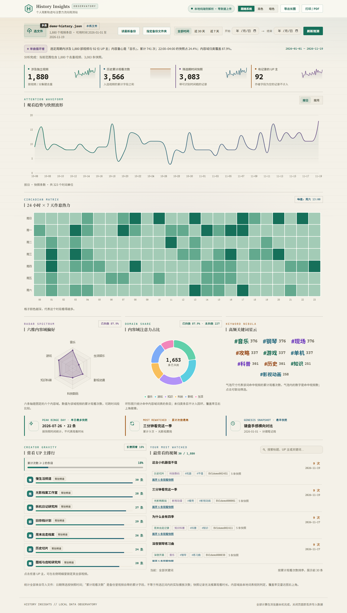
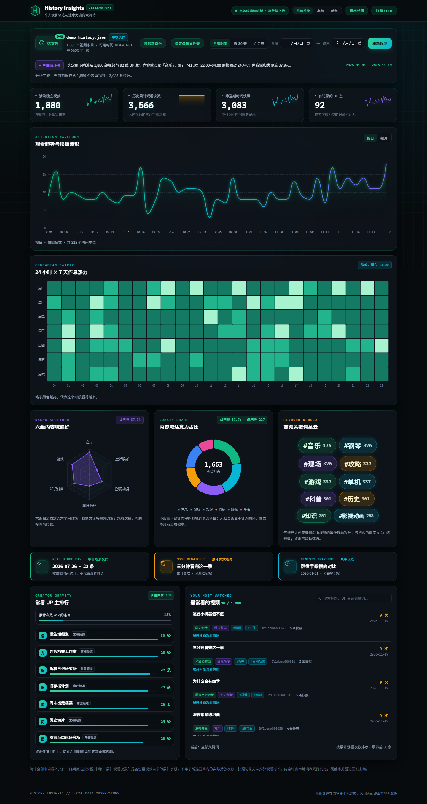

# Bart 的用户脚本

  

面向 Bilibili 的浏览器用户脚本。项目按可独立安装和维护的脚本划分；本仓库继续作为总目录和发行源，不需要额外克隆子仓库。

English version: [README.en.md](README.en.md)

> **桌面上看自己的观看历史？** [History Insights 安装包（Windows）](https://github.com/yanguanbai/script/releases/latest/download/HistoryInsights-Setup.exe) · [免安装便携版 / 全部版本](https://github.com/yanguanbai/script/releases/latest) —— 把「观看历史可回溯」导出的备份拖进去，就是一份本地生成的年度报告，数据不出本机。

## 脚本

还没装过油猴？先装 [Tampermonkey](https://www.tampermonkey.net/) 或 [Violentmonkey](https://violentmonkey.github.io/get-it/)，装完刷新一下浏览器，再点下表里的「安装」。

| 脚本 | 用途 | 版本 | 安装 |
|---|---|---:|---|
| [观看历史可回溯](src/bilibili-history/README.md) | 本地记录观看时间、进度和历史快照，支持搜索、备份与恢复 | 5.10.23 | [中文文档](src/bilibili-history/README.md) · [English](src/bilibili-history/README.en.md) · [安装](https://raw.githubusercontent.com/yanguanbai/script/main/src/bilibili-history/bilibili-history.user.js) · [更新记录](https://github.com/yanguanbai/script/commits/main/src/bilibili-history/bilibili-history.user.js) |
| [浏览足迹](src/bilibili-footprint/README.md) | 记录列表页出现过的视频并支持搜索回溯 | 10.3.1 | [中文文档](src/bilibili-footprint/README.md) · [English](src/bilibili-footprint/README.en.md) · [安装](https://raw.githubusercontent.com/yanguanbai/script/main/src/bilibili-footprint/bilibili-footprint.user.js) · [更新记录](https://github.com/yanguanbai/script/commits/main/src/bilibili-footprint/bilibili-footprint.user.js) |
| [干净链接](src/bilibili-clean-link/README.md) | 清理 Bilibili 链接中的追踪参数 | 3.3.0 | [中文文档](src/bilibili-clean-link/README.md) · [English](src/bilibili-clean-link/README.en.md) · [安装](https://raw.githubusercontent.com/yanguanbai/script/main/src/bilibili-clean-link/bilibili-clean-link.user.js) · [更新记录](https://github.com/yanguanbai/script/commits/main/src/bilibili-clean-link/bilibili-clean-link.user.js) |

代码分层、CSS 样式族与「片段 → 创建者」对照见 [docs/STRUCTURE.md](docs/STRUCTURE.md)。

## 本地分析工具

[History Insights](tools/history-insights/README.md)（[English](tools/history-insights/README.en.md)）把「观看历史可回溯」导出的 JSON 备份在**本机**解析成一份可交互的观看报告：按日/按月波形、24 小时 × 7 天作息热力图、六维内容域雷达与占比环形、高频关键词星云、常看 UP 主与最常看的视频。不登录、不联网、不上传文件。

启动：双击仓库根目录的 `看我的观看历史.cmd`，它会启动服务、自动找到最新的脚本备份并打开报告；也可以手动 `node tools/history-insights/server.mjs` 后在页面里点「读最新备份」或自己选文件。备份有几份就一起给：点「选文件（多选）」一次挑多个，或者分批点、后挑的会追加，重复记录自动合并去重。

装了发行版之后更简单：桌面「观看报告」双击就先用内置 Node 在后台起服务，再打开 `http://127.0.0.1:4173`（不弹黑窗口）。不要直接双击程序目录里的 `app\report.html`——那是离线单文件版，读备份 / 指定目录 / 导出这些要靠服务的按钮会变成禁用状态。

只想起停服务：双击根的 `服务启停.cmd`，一次启动（会在浏览器打开报告），再双击就停掉。

两种装法：不想碰命令行的到 [Releases](https://github.com/yanguanbai/script/releases/latest) 下载 `HistoryInsights-Setup.exe`（自带便携 Node，装完桌面有「观看报告」图标，可正常卸载）；想改代码的就用上面这条命令行的路子，依赖已在 `vendor/`，不需要 `npm install`。

升级：新版 Setup 双击覆盖旧版就行——它会先停掉还在跑的服务、整个重建程序目录（旧文件不会残留），版本号写进 `version.txt`；你自己指定的备份目录保持不变。

两套独立设计：亮色是纸本（米白纸面、细墨线分节、宋体标题），暗色是观测台（玻璃面板、霓虹光阶）；「导出长图」与「打印 / PDF」由本地服务另起干净的浏览器渲染，不带浏览器插件挂件，暗色主题导出仍是暗色。效果样张：[docs/展示.md](tools/history-insights/docs/展示.md)。

| 纸本（亮色） | 观测台（暗色） |
|---|---|
|  |  |

备份放在哪由你决定：页面里的「指定备份文件夹」会弹系统选择框，选完记进 `%APPDATA%\HistoryInsights\config.json`，以后只认这个目录。仓库里不含任何真实备份——上面的样张和 PDF 都是用 `tests/make-demo-backup.mjs` 生成的合成数据渲染的。

## 安装

1. 安装 Tampermonkey 或 Violentmonkey 浏览器扩展。
2. 点击上表对应的“安装”链接，并在扩展弹出的安装页确认。
3. 安装后刷新匹配的网站页面。

脚本偏好和记录保存在浏览器的用户脚本管理器本地存储中。卸载扩展或清除扩展数据前，请先用脚本提供的导出功能备份重要记录。

## 配置

普通用户不需要编辑脚本源码。浏览足迹与观看历史的常用选项可从脚本面板或扩展菜单调整。配置只保存在本机，不上传到本仓库。

## 发行与更新

脚本以独立版本号维护，完整源码保存在各自 `src/` 子目录。上表 Raw 地址可直接安装；Tampermonkey 或 Violentmonkey 会按脚本元数据检查更新。Greasy Fork 上的安装和更新仍由 Greasy Fork 管理。

上表「版本」列不手写：`node tools/sync-readme-versions.mjs` 从每个脚本头部的 `@version` 回填，改了脚本版本跑一次就行；CI 会带上 `--check` 校验，两边不一致直接失败。

头图也不是手截的：改 `docs/banner.html` 的文案后跑 `node docs/build-banner.mjs`，无头 Chrome 会重出 `docs/banner.png` 与 2x 版。

当前仓库保留原仓库历史；键盘控制脚本为维护者私用，不属于公开发行集合。`tools/` 里是本地分析工具 History Insights，独立运行，不随脚本一起安装。

## 许可证

本仓库采用 [MIT 许可证](LICENSE)。三个公开脚本在头部各自声明 `@license MIT`；`tools/history-insights/` 及其构建、安装脚本同样适用 MIT。`vendor/` 下的第三方文件保持原许可证：ECharts（Apache-2.0）、segmentit（MIT），详见 [发行来源说明](DISTRIBUTION.md)。
