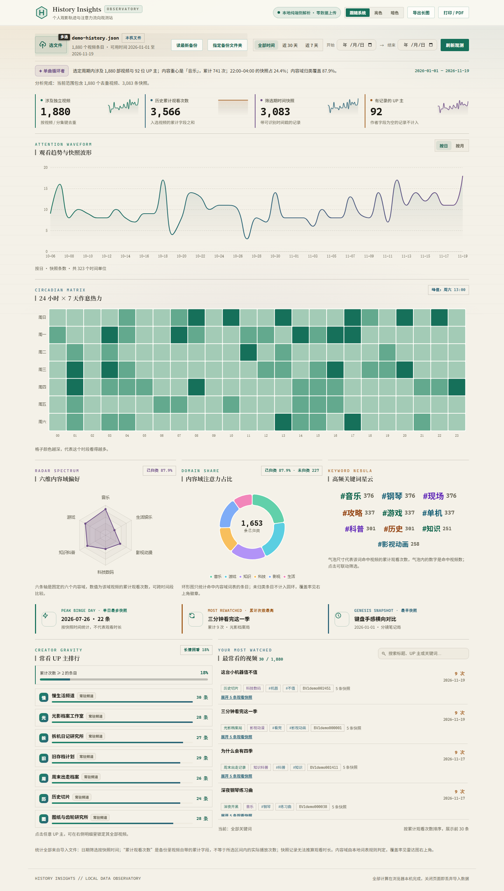
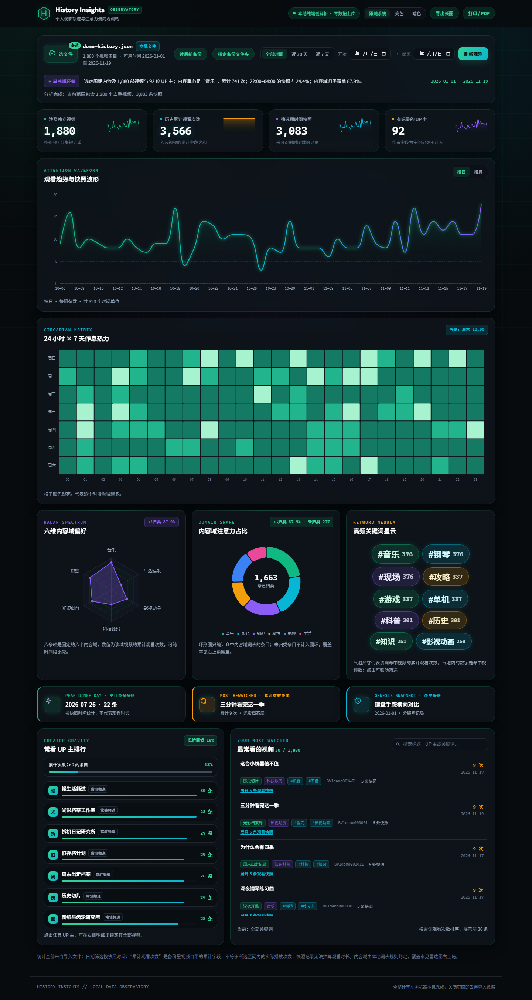

# History Insights（本地观看历史分析）

[English](README.en.md) · **[下载最新版](https://github.com/yanguanbai/script/releases/latest)**（Windows 安装包 / 便携包，自带运行时，不用装 Node）

History Insights 是一个本地运行的观看历史分析页面。它把导出的观看历史整理成日期趋势、观看时段、关键词、内容类型、UP 主和高频视频视图。分析在浏览器 Worker 中运行，不需要登录、API Key 或分析服务。

数据来自 [观看历史可回溯脚本](../../src/bilibili-history/README.md) 导出的 JSON 备份；两者配合，可以把自己几年的 B 站观看记录变成一份可交互的年度报告。

想看效果先看样张：[docs/展示.md](docs/展示.md)（两套设计 + 打印 PDF）。

| 纸本（亮色） | 观测台（暗色） |
|---|---|
|  |  |

## 启动

两种装法，按人挑：

**一、装发行版（不想碰命令行就用这个）**

1. 到 [Releases](https://github.com/yanguanbai/script/releases/latest) 下载 `HistoryInsights-Setup.exe`（约 36 MB，自带节点运行时，别人的电脑也不用装 Node），双击安装。不想安装就用同一页的 `HistoryInsights-*-portable.zip`，解压后双击 `打开报告.cmd`。
2. 装完桌面和开始菜单会多一个「观看报告」，双击它：先确保本地服务在跑（后台起一个，窗口不弹），再用浏览器打开 `http://127.0.0.1:4173`——「读最新备份 / 指定备份文件夹 / 导出长图 / 打印 PDF」都要靠这个服务，所以入口一律走服务，不直接开 html。把备份拖进去就出报告。

   注意：`app\report.html` 是单文件离线版，直接双击也能看，但页面上「读最新备份」「指定备份文件夹」「导出」会被禁用并提示——没有服务就没有这些能力。
3. 需要导出长图 / PDF 时用开始菜单里的「导出长图与 PDF」。想卸载去「设置 → 应用 → 已安装的应用」，或开始菜单里的卸载项。

安装包内置了单文件网页版和便携 Node，所以别人的电脑不用装 Node、不用开终端。装在当前用户目录，不弹管理员权限。

**关于 Node**：启动脚本按「内置 `node\node.exe` → PATH 里的 node → 常见安装目录（`Program Files\nodejs` 等）」的顺序找运行时，正常情况用的就是安装包自带的那个，跟你电脑上装没装 Node、装的是哪个版本无关。三处都没有时会弹一个说明框：装的发行版就提示「内置运行时不见了，多半是解压不全或被杀软删了，重装最省事」，用源码跑的则提示先装 Node，并给出下载页入口——不会静默退出。仓库里那两个 `.cmd` 入口同样先找 PATH、再找 `Program Files\nodejs`，都没有才提示并打开下载页。

**装在哪里由你选**：首次安装会弹一个目录选择框，预选的是 `%LOCALAPPDATA%\Programs\HistoryInsights`，直接点「确定」就用它；想放 D 盘就选一个父目录（例如 `D:\Apps`），它会自动在下面建 `HistoryInsights` 子目录，不会把文件铺进你选的目录里；点「取消」则什么都不写。之后升级会自动沿用上次那个位置，不再重复问。命令行也能指定完整路径：`install.ps1 -Dir "D:\Apps\HistoryInsights"`。

**升级就再装一次**：新版 Setup 直接双击覆盖旧版即可。安装时会先按端口（4173）停掉正在跑的服务，然后整个重建 `app` 目录——旧版本留下的文件（包括以前叫 `观看报告.html` 的那份）都会被清掉，不会出现新旧混杂。程序目录里会写一个 `version.txt`，「设置 → 应用」里的版本号也会跟着更新。**你自己指定的备份目录（`%APPDATA%\HistoryInsights\config.json`）不受影响**，装完还是原来那个目录。

**二、直接用仓库（想改代码就用这个）**

1. 双击仓库根目录的 `看我的观看历史.cmd`（或本目录的 `一键看报告.cmd`）。它会自己启动本地服务，然后在「下载」「桌面」「文档」「OneDrive\下载」这些默认位置里找最新的 `bvh_history_backup_*.json`，找不到就打开空白页等你指定。
2. 只想起停服务就用 `启停.cmd`（仓库根目录叫 `服务启停.cmd`）：双击一次启动并打开报告，再双击一次就停掉；要看状态或停掉别的端口用 `powershell -File service.ps1 -Action status|stop -Port 4173`。
3. 或者手动跑：`node tools/history-insights/server.mjs`，打开终端显示的本地地址（默认 `http://127.0.0.1:4173`），点「读最新备份」或自己选文件。

**备份放在哪，由你决定**：菜单里的「指定备份文件夹」会弹一个系统文件夹选择框，选完把路径记在用户配置 `%APPDATA%\HistoryInsights\config.json` 里，以后每次启动只认这个目录（优先于默认位置）。所以不必把备份塞进固定的某个盘，也不用改代码里的路径。

没指定之前，「读最新备份」会依次扫这些地方：`HISTORY_DIR` 环境变量、`下载`、`桌面`、`文档`、OneDrive 的下载和桌面，**以及浏览器自己设的下载目录**——程序会读 Chrome / Edge / Brave / Vivaldi / Chromium / 360 极速的 `User Data\<Profile>\Preferences` 里 `download.default_directory`，和 Firefox 各配置文件 `prefs.js` 里的 `browser.download.dir`。所以只要你把备份存在浏览器默认下载的位置（哪怕下到了 D 盘某个文件夹），也能直接被找到。读这些配置是只读、不联网的；浏览器下载目录里只有严格命名为 `bvh_history_backup*.json` 的才认，避免把无关的 json 当备份。

两种装法都不需要 `npm install`（依赖已经放进 `vendor/`）。

**发行与更新（维护者用）**：安装包不在仓库里，而是挂在 GitHub Releases 上，`release/dist/` 已在 `.gitignore` 里。发新版本三步：

1. 在仓库根目录执行 `pwsh -File tools/history-insights/release/build.ps1`，产物落到 `release/dist/`：`HistoryInsights-Setup.exe`（自解压安装包，约 36 MB）和 `HistoryInsights-<版本>-portable.zip`（解压即用，不写注册表）。
2. 提交代码并打标签：`git tag -a v1.0.0 -m "History Insights 1.0.0"` → `git push origin main --tags`。
3. 用标签建 Release，把两个产物作为 assets 传上去（`gh release create v1.0.0 release/dist/*.exe release/dist/*.zip`，没有 gh 就用网页「Attach binaries」）。

导入：点「选文件」（按钮带「多选」标记）可以一次选好几份备份；想分批来就再点一次，新文件会**追加**进去，同名同大小的不重复读，记录级的重复也会自动合并——两次导出里都有的视频只算一条，快照取并集。也可以直接把多个文件拖进面板。导入之后可以选“全部、近 30 天、近 7 天”，或者自己指定开始/结束日期。页面有两套独立设计：亮色是纸本（无卡片、细墨线分节），暗色是观测台（玻璃面板与霓虹光阶），样张见 [docs/展示.md](docs/展示.md)。

**仓库里不含任何真实记录**：`docs/` 下的截图和 PDF 都是用 `node tests/make-demo-backup.mjs` 生成的合成数据渲染的，`tests/fixtures/*.json` 已在 `.gitignore` 里，不会被提交。

「导出长图」和「打印 / PDF」都不在当前页面里重排：前端把原始数据发给本地服务，服务端另起一台干净的 Chrome（临时配置目录、不加载任何扩展）渲染后回传 PNG 或 PDF。所以页面不会抖，输出里不会带浏览器插件挂件，暗色主题导出的 PDF 也仍是暗色。

## 页面内容

- **数据概览**：按视频/分集键去重的条目数、入选条目的累计观看次数、所选时间范围内的快照数，以及有名称的 UP 主数。四个小图分别表示每日快照涉及视频数、按累计观看次数排序的视频分布、快照数量趋势和每日涉及 UP 主数。
- **观看趋势**：按日或按月统计快照条数。
- **观看时段**：24 小时 × 7 天热力图独占整行，高度按 24:7 的绘图比例给（CSS `aspect-ratio`），格子接近正方形；统计快照时间，不代表播放时长。
- **六维内容域偏好雷达**：六条轴固定为「音乐、游戏、知识科普、科技数码、影视动漫、生活娱乐」，数值是该域视频的累计观看次数，因此不同时间段之间可以直接比较；面板右上角显示词表归类覆盖率。
- **内容域注意力占比**：环形图按视频条目数统计六个内容域（只含已归类条目），面板右上角徽章给出归类覆盖率与未归类条数，圆心文字固定显示，不会被悬浮提示遮挡。
- **高频关键词星云**：取前十个关键词，字号随命中视频的累计观看次数连续变化，气泡内数字是命中视频数；点击词条可筛选视频列表，再次点击取消。
- **记录摘要**：单日快照最多的日期、备份累计观看次数最高的视频、最早可识别的快照。没有足够源数据时会明确显示无记录。
- **UP 主与视频**：UP 主按关联视频的累计观看次数排序，并给出「累计次数 ≥ 2」的长情回看比例；视频列表展示标题、编号、UP 主、内容域、关键词、进度、快照数和可展开的快照明细。视频标题只在点击时打开 Bilibili。

## 数据口径

日期筛选按记录中的快照时间进行。累计观看次数来自视频记录里的累计字段，筛选日期后仍表示入选视频的历史累计次数之和，不代表所选时间段实际播放次数。快照不能推算真实观看时长。UP 主重复观看比例的分母为有 UP 主名称的去重视频条目，分子为累计观看次数大于 1 的条目；这不是用户级播放事件次数。

分析器支持 `bvh-history-backup` v2、顶层数组，以及包含 `records`、`items`、`history` 或 `data` 集合的常见 JSON 格式，也支持 CSV 文件。合集分集会展开；相同视频键会合并，累计次数取较大值，重复快照按时间、位置、来源和进度去重。全部时间分析包含没有可识别时间戳的记录；指定日期范围时，无日期记录不计入。

中文关键词使用本地分词库 `segmentit` 对标题与标签分词，按词性丢弃代词、助词、副词、连词和数词，再叠加内置主题词表并过滤停用词；不做 AI 语义判断。内容域由 `content-domains.mjs` 的固定词表按命中词数与词长加权打分，最高分所属域即为结果，零分记为「未归类」并在雷达徽章里显示覆盖率。两者都是规则统计，不是兴趣因果结论。

## 视觉与兼容

页面有两套独立的设计语言，而不是同一套配色开关：**深空**主题是黑色底 + 极光光晕 + 毛玻璃卡片 + 霓虹强调色；**纸本**主题是米色纸面 + 细墨线 + 宋体标题 + 方形卡片 + 低饱和墨绿/墨蓝/藤紫，按钮、里程碑图标、关键词气泡、环形图配色都按纸面重新调过，不是把霓虹关掉了事。主题选择写在 `<html data-theme>`，实际生效的调色板写在 `<html data-palette>`（`space` / `paper`），跟随系统时由 `prefers-color-scheme` 决定。

页面按 12 列栅格组织：趋势与热力各占一整行，雷达/环形/星云为 4:4:4，UP 主与明细为 5:7；1024px 以下并列为两列，860px 以下全部单列，560px 以下进一步压缩字号与內边距；图表同时监听窗口和自身容器尺寸，缩放窗口或放大页面时不会截断。

热力图的格子颜色按分位数分级（0、中位、75、90、95 分位五档），而不是线性映射——快照时间高度集中时，线性色阶会把除峰值外的格子全部压成一个颜色。

打印前会临时切到纸本调色板并关掉所有入场动画（否则带 `rise` 动画的面板在打印布局里会停在 `opacity: 0`，整页变空白），再按 A4 版面宽度（约 660px）把图表重画一遍，画布尺寸与纸张容器一致，所以不拉伸、不裁切、不出现空白页。「导出长图」同样走纸本调色板（与打印出来的 PDF 是同一套颜色，无论当前是亮色还是暗色），用同一份数据在 canvas 里重新绘制 PNG，图表会先按海报里的目标尺寸重画再取图，避免大画布缩小后格线糊成色块；过程中不截屏，所以浏览器插件和挂件不会被带进去。

## 隐私与依赖

JSON/CSV 文件由本机 Web Worker 读取和分析，不会发到服务端。页面静态文件、Apache ECharts 5.5.0 与中文分词库 `segmentit` 2.0.3 一并保存在仓库中，不依赖 CDN；ECharts 的 Apache-2.0 与 segmentit 的 MIT 许可文本分别在 `vendor/echarts.LICENSE`、`vendor/segmentit.LICENSE`。本地服务只绑定 `127.0.0.1`。打开 Bilibili 视频链接只会在用户点击后发生。

关闭标签页后页面不会保留导入的历史数据；主题选择保存在当前浏览器的 `localStorage`。

## 文件职责

- `index.html`、`observatory.css`：观测台结构和主题样式。
- `app.js`：图表、筛选、视频明细与页面交互。
- `worker.js`：读取文件、后台运行归一化和统计。
- `analytics.mjs`：字段兼容、去重、分词、关键词与统计口径。
- `content-domains.mjs`：六个内容域的词表与归类打分函数。
- `server.mjs`：只提供本地静态文件。
- `vendor/`：离线使用的 ECharts、segmentit 文件及许可证。
