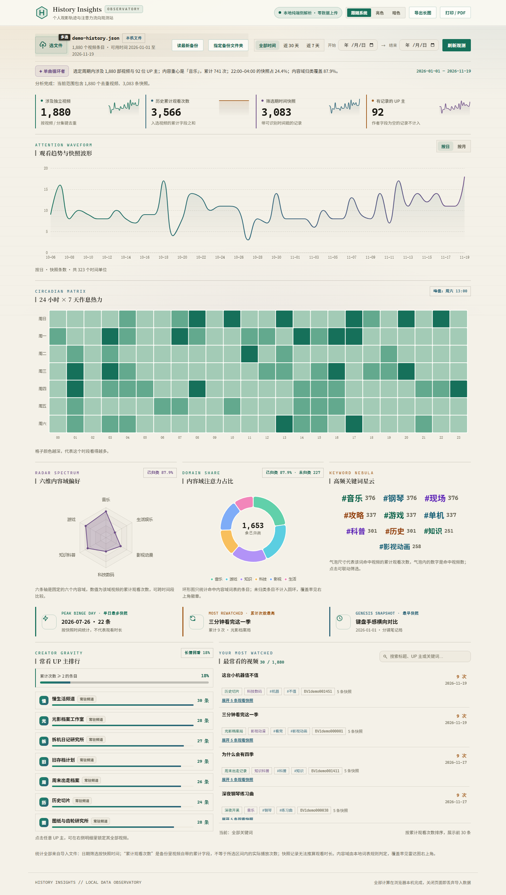
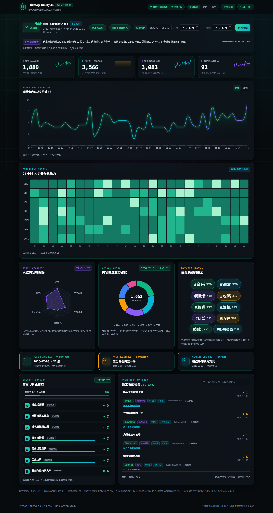

# History Insights · 两套设计语言的样张

它是一份**自己看的年度报告**，不是给别人看的作品集：数据不出本机，配色不讨好任何人。

这个页面只有两套设计，不是同一套颜色调暗或调亮：亮色是「纸本」，暗色是「观测台」。排版结构、边框、配色各写一套，切主题时整页换的是设计语言，不只是换色值。

## 从哪来，怎么跑

数据来自 [观看历史可回溯脚本](../../../src/bilibili-history/README.md) 导出的 JSON 备份；本工具把这份备份读进浏览器 Worker 里算，再画成页面。

1. 装了发行版：双击桌面「观看报告」，它会在后台起本地服务（不弹黑窗），然后用浏览器打开 `http://127.0.0.1:4173` —— 读备份、指定目录、导出都靠这个服务，所以不要直接双击 `app\report.html`（离线版里那几个按钮是禁用的）
2. 用仓库：双击仓库根目录的 `看我的观看历史.cmd`：它自己起服务，并去「下载」「桌面」「文档」等默认位置找最新的备份
3. 想手动就运行 `node tools/history-insights/server.mjs`，打开地址后点「读最新备份」
4. 备份不止一份：点「选文件」一次选多个，或者分批导入（后选的会追加），重复的记录自动合并去重
5. 备份不在默认位置也没关系：点「指定备份文件夹」选一个长期存放的目录，路径会记下来，下次直接用它
6. 数据读进来后等两三秒，报告就出来了

> 下面所有截图和 PDF 都是用仓库里的合成演示数据渲染的（`node tests/make-demo-backup.mjs` 生成，UP 主和标题都是编的），不含任何人的真实观看记录。

完整说明：[工具 README](../README.md) · [仓库首页](../../../README.md)

## 纸本（亮色）

米白纸面，没有卡片、没有圆角、没有阴影，只用一条细墨线分节；标题换宋体带前导竖线，KPI 靠左侧色条立柱，里程碑是左竖线的引文块，关键词星云只剩文字（字号分层 + 四种墨色，不带胶囊、不带光晕），图表用细线、少填充。

热力图格子按 24 列 × 7 行反算：`height: calc(29.17cqw + 30px)` + 容器查询，窗口怎么缩放格子都保持正方形。

## 观测台（暗色）

深色玻璃面板、霓虹光晕、渐变波形，星云关键词是带气泡的胶囊，热力图是深绿到浅薄荷的五档色阶，格子同样是正方形。这套是页面最初的样子。

## 打印与导出

屏幕、PDF、整页 PNG 三处的尺寸规则是同一套：图表按目标宽度重画，热力图高度由同一个公式反算，不存在“屏幕一套、纸上另一套”的第二份计算。

打印样式跟着当前主题走：暗色主题导出 PDF 仍然是暗色（不会强制翻成白纸），亮色主题导出就是上面那张纸本。纸面上不再重复图下那句说明，避免和图轴文字挤在一起。

导出不在当前页面上重排，也不由页面 canvas 重画：前端把原始数据 POST 给本地服务，服务端另起一台干净的 Chrome（临时配置目录、不加载任何扩展）渲染，再回传 PDF 或整页 PNG。所以页面不会抖，输出里也不会混进浏览器插件挂件。

- [暗色 PDF 样张（3 页）](report-dark.pdf)
- [亮色 PDF 样张（3 页）](report-light.pdf)

## 一处修过的细节

星云关键词原本按 `index × 0.45s` 依次入场，第 10 个词要 4 秒后才出现，所以截图或导出时常只看见前几个。现在改成 `index × 0.05s`，十个词半秒内全部落位。
